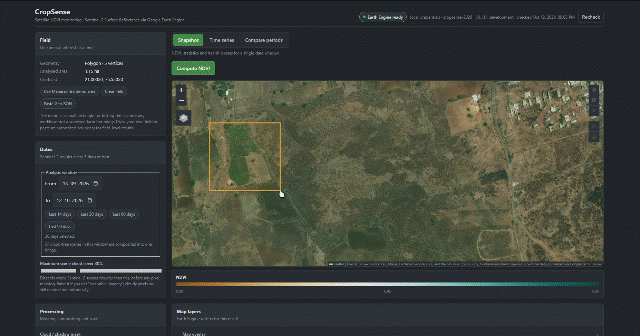

# CropSense

**Satellite-based crop health monitoring using NDVI.**

CropSense analyses agricultural vegetation condition from Sentinel-2 Level-2A
surface reflectance, retrieved and processed through Google Earth Engine. It
computes NDVI over a user-drawn field boundary, reports zonal statistics,
classifies vegetation condition into configurable categories, tracks NDVI over
time, and screens for areas of significant decline.

## Project walkthrough

[](docs/assets/cropsense.mp4)

The preview loops continuously. Click it to open the full 60-second screen
recording, which includes a completed NDVI analysis result.

> ### What NDVI can and cannot tell you
>
> NDVI measures **vegetation vigour** — how much green, photosynthetically
> active canopy a pixel contains. It is a genuine, well-established proxy for
> crop condition and biomass.
>
> It does **not** diagnose crop disease, identify pests, or determine the cause
> of any change it detects. A drop in NDVI is equally consistent with harvest,
> tillage, lodging, waterlogging, drought, nutrient deficiency, pest pressure
> and normal end-of-season senescence. CropSense therefore reports
> **"potential vegetation stress requiring ground verification"** and never
> claims a diagnosis.
>
> No accuracy or validation metrics are reported anywhere in this project,
> because none have been established for this deployment against ground truth.
> See [docs/LIMITATIONS.md](docs/LIMITATIONS.md).

The separate path to multi-farm Maharashtra coverage, including authorized
parcel data requirements and quota-aware rollout, is documented in
[docs/MAHARASHTRA_REGIONAL_MONITORING.md](docs/MAHARASHTRA_REGIONAL_MONITORING.md).
For the state data authorization request and the bounded, resumable pilot
runner, see the [data-access request guide](docs/data-access-requests/REGIONAL_DATA_ACCESS_REQUEST.md).

---

## Status

| Component | State |
| --- | --- |
| Backend — FastAPI + Earth Engine service layer | **implemented** |
| NDVI computation, statistics, classification | **implemented** |
| Temporal analysis and trend fitting | **implemented** |
| Change detection / decline screening | **implemented** |
| Tile-URL generation for map display | **implemented** |
| Backend tests, Ruff, mypy | **115 passed; 2 skipped in the offline suite; opt-in live Earth Engine analysis test passes separately** |
| Frontend — React + TypeScript dashboard | **implemented; lint, type check and production build passing** |
| Frontend utility tests (6) | **passing** |
| Frontend browser tests | **4 mocked API end-to-end tests pass in Microsoft Edge** |
| Docker Compose | **configuration valid; local backend, frontend and API proxy verified** |
| Analysis persistence | **local SQLite history implemented; not multi-user storage** |
| Live Earth Engine credentials and analysis | **verified** — real Sentinel-2 analysis passed for a small Maharashtra sample AOI |
| Maharashtra regional monitoring | **single-area monitoring works now by drawing an AOI or using the clearly labeled Jalgaon demo rectangle; multi-farm hectare coverage still requires authorized boundaries and a matching official denominator** |

In a local verification, the live setup check queried the Sentinel-2 collection,
and the opt-in integration test completed a real analysis through the Docker
frontend/API proxy over the small demo rectangle near Jalgaon, Maharashtra
(2026-09-12 through 2026-10-12:
6 scenes, mean NDVI 0.2913, 98.49% valid pixels, approximately 1.15 ha). This
confirms data access and processing for that rectangle; it is not a surveyed
farm boundary, validation of a user-supplied field, or a crop-health accuracy
claim. The dashboard labels the demo geometry accordingly. The API deliberately
boots in degraded mode when Earth Engine configuration is missing and reports
what needs attention from `GET /health`.

---

## Quick start

Create a local environment file from the template, then configure the Earth
Engine project ID. Keep credentials outside the repository:

```bash
cp .env.example .env
./backend/.venv/Scripts/python.exe scripts/check_setup.py
```

The setup check reports what is configured and how to resolve missing items.
After authenticating Earth Engine, verify the live connection:

```bash
./backend/.venv/Scripts/python.exe scripts/check_setup.py --live
```

Run the backend:

```bash
cd backend && ./.venv/Scripts/python.exe -m uvicorn app.main:app --reload --port 8000
```

In a second terminal, run the frontend:

```bash
cd frontend && npm ci && npm run dev
```

Dashboard: <http://localhost:5173> · API docs: <http://localhost:8000/docs>

To run the containerised app with local Earth Engine authentication:

```powershell
docker compose -f docker-compose.yml -f docker-compose.local-ee.yml up --build -d
```

Completed analyses are stored in a local SQLite database at `./data/cropsense.sqlite3`
when running from the repository. The Compose backend stores it in the persistent
`cropsense_data` volume. This is a local single-user history, not user/account
management; do not expose it publicly without authentication and access controls.

Crop-specific threshold validation needs your own dated field observations. Start
with [`docs/calibration_observations_template.csv`](docs/calibration_observations_template.csv)
and follow [`docs/THRESHOLD_CALIBRATION.md`](docs/THRESHOLD_CALIBRATION.md). No
accuracy score is claimed until independent observations are collected.

The containerized dashboard is available at <http://localhost:8080>. The local
Earth Engine override mounts the credential directory read-only; credentials
are not copied into either image. Without credentials, the backend starts in
degraded mode and reports the setup issue through its health endpoint.

Full walkthrough, including service-account setup for servers and Docker:
[docs/SETUP.md](docs/SETUP.md).

---

## Architecture

```
┌─────────────────────────────────────────┐
│  Frontend (React + TypeScript)          │  AOI drawing, map overlays,
│  Leaflet map · charts · controls        │  charts, legends, loading states
└──────────────────┬──────────────────────┘
                   │  JSON over HTTP (no Google credentials in the browser)
┌──────────────────▼──────────────────────┐
│  API layer            app/api/          │  routing, validation, error envelope
├─────────────────────────────────────────┤
│  Orchestration        app/services/     │  analysis_service.py
│                                         │  request → pipeline → response
├─────────────────────────────────────────┤
│  Analysis             app/services/     │  ndvi_service.py  (EE expressions)
│                                         │  metrics.py       (pure Python)
├─────────────────────────────────────────┤
│  Earth Engine gateway app/services/     │  gee_service.py
│  ── the ONLY module that touches ee ──  │  auth, catalogue, masking,
└──────────────────┬──────────────────────┘  reducers, tile URLs
                   │  Earth Engine Python API
┌──────────────────▼──────────────────────┐
│  Google Earth Engine                    │
│  COPERNICUS/S2_SR_HARMONIZED            │
│  GOOGLE/CLOUD_SCORE_PLUS/V1/...         │
└─────────────────────────────────────────┘
```

Two boundaries matter and are enforced by structure, not convention:

* **`gee_service.py` is the sole Earth Engine gateway.** Authentication,
  catalogue queries, cloud masking, reducers, `getInfo` calls and tile
  registration all live there. Swapping data source or auth strategy touches
  one file.
* **`metrics.py` imports no `ee`.** Every numeric decision — percentages, area
  conversion, trend fitting, reliability warnings — is plain Python and is unit
  tested without credentials. That is why the 115-test suite runs offline.

`app/api/dependencies.py` is the single dependency-injection seam. Routes depend
on the providers there, so overriding one provider in a test replaces the Earth
Engine client for every route beneath it.

### Repository layout

```
AgroVita/
├── .env.example              # every variable, documented inline
├── backend/
│   ├── app/
│   │   ├── main.py           # app factory, lifespan, error handlers
│   │   ├── api/
│   │   │   ├── dependencies.py   # DI providers — the test override seam
│   │   │   ├── router.py
│   │   │   └── routes/{system,ndvi}.py
│   │   ├── core/{config,exceptions,logging_config}.py
│   │   ├── models/vegetation.py  # health classes, palettes, science caveats
│   │   ├── schemas/{aoi,common,ndvi,system}.py
│   │   └── services/
│   │       ├── gee_service.py       # Earth Engine gateway
│   │       ├── ndvi_service.py      # NDVI + classification expressions
│   │       ├── analysis_service.py  # orchestration
│   │       └── metrics.py           # pure-Python numerics
│   ├── tests/                # unit suite plus opt-in live GEE smoke test
│   └── pyproject.toml        # pytest / ruff / mypy config
├── docs/
├── frontend/                 # React + TypeScript dashboard
└── scripts/check_setup.py    # environment pre-flight
```

---

## API

| Method | Path | Purpose |
| --- | --- | --- |
| `GET` | `/` | Service index |
| `GET` | `/health` | Liveness plus Earth Engine readiness and remediation steps |
| `GET` | `/api/system/config` | Non-sensitive server defaults for the frontend |
| `GET` | `/api/system/gee-test` | Live Earth Engine round trip |
| `GET` | `/api/history?limit=20` | Recent local SQLite analyses |
| `GET` | `/api/history/{id}` | Stored request/result (without expired map URLs) |
| `DELETE` | `/api/history/{id}` | Delete a saved history entry |
| `POST` | `/api/ndvi/analyze` | NDVI, statistics, health classes and map layers for an AOI |
| `POST` | `/api/ndvi/timeseries` | Mean NDVI over time plus a linear trend |
| `POST` | `/api/ndvi/change` | Compare two periods, flag potential stress areas |

`GET /api/system/config` exposes thresholds, band names, collection IDs and
guard-rail limits — deliberately **not** the project ID, service-account email
or any credential. A test asserts the response body contains none of those
strings.

Errors use one envelope throughout:

```json
{ "code": "no_imagery", "message": "…", "details": { } }
```

`503 earth_engine_auth_error` carries a `details.remediation` array of concrete
setup steps, so a misconfigured deployment explains itself.

### Example

```bash
curl -X POST http://localhost:8000/api/ndvi/analyze \
  -H 'Content-Type: application/json' \
  -d '{
        "aoi": {"type":"Polygon","coordinates":[[[75.800,30.900],[75.812,30.900],[75.812,30.908],[75.800,30.908],[75.800,30.900]]]},
        "start_date": "2024-01-01",
        "end_date": "2024-01-31",
        "cloud_threshold": 30
      }'
```

Read the `warnings` array in every response before trusting the numbers. It
reports low cloud-free coverage, single-scene composites, cloud-mask downgrades
and other reliability caveats that the headline statistics do not show.

---

## How the analysis works

1. **Filter** `COPERNICUS/S2_SR_HARMONIZED` by AOI, date range and scene-level
   `CLOUDY_PIXEL_PERCENTAGE`.
2. **Mask** cloud, cirrus and cloud shadow per pixel. Default is
   **Cloud Score+** (`cs_cdf` band, threshold 0.60), the currently recommended
   Sentinel-2 cloud product. `scl`, `qa60` and `none` are also selectable;
   Cloud Score+ covers 2017-06-27 onward and the backend downgrades to SCL with
   a warning for earlier windows.
3. **Scale** stored integers to reflectance (DN × 1e-4).
4. **Composite** the masked scenes — `median` (default), `mean`, `greenest`
   (`qualityMosaic` on NDVI) or `most_recent`.
5. **Compute** `NDVI = (B8 − B4) / (B8 + B4)` at 10 m, Sentinel-2 native
   resolution for both bands.
6. **Reduce** over the AOI for mean, min, max, median, standard deviation and
   percentile spread — masked pixels excluded, never counted as zero.
7. **Classify** into five configurable categories and compute the area and
   percentage of each.
8. **Warn** when cloud-free coverage of the AOI is low, when only one scene
   contributed, or when the valid-pixel fraction makes the statistics unreliable.

Missing imagery is reported as `404 no_imagery`, never filled in. Cloud-masked
pixels are excluded from every statistic rather than defaulted. There is no
synthetic, simulated or placeholder satellite data anywhere in this project.

---

## Classification thresholds are configurable, and must be calibrated

The default NDVI class boundaries are `0.2, 0.4, 0.6, 0.8`, giving:

| Class | Default NDVI range |
| --- | --- |
| Very low / non-vegetated | < 0.2 |
| Low | 0.2 – 0.4 |
| Moderate | 0.4 – 0.6 |
| Healthy | 0.6 – 0.8 |
| Very healthy | ≥ 0.8 |

**These are generic starting points, not universal truths.** The NDVI value that
indicates a healthy crop depends on crop type, phenological stage, canopy
architecture, row spacing, soil background, region, season, sun-sensor geometry
and residual atmospheric effects. A wheat field at tillering and the same field
at booting have very different "healthy" NDVI. NDVI also saturates at high
biomass, so it discriminates poorly among dense canopies.

Override them per deployment with `NDVI_CLASS_THRESHOLDS` in `.env`, or per
request in the `options.ndvi_class_thresholds` field. Every response reports
which thresholds were used and whether they came from the request or the server
default. See [docs/THRESHOLD_CALIBRATION.md](docs/THRESHOLD_CALIBRATION.md).

---

## Development

```bash
cd backend && ./.venv/Scripts/python.exe -m pytest tests -q
```

```bash
cd backend && ./.venv/Scripts/python.exe -m ruff check . && ./.venv/Scripts/python.exe -m ruff format --check . && ./.venv/Scripts/python.exe -m mypy
```

Current state: **115 passed, 2 skipped** in the backend run; Ruff and mypy were
clean across 27 source files. The live Earth Engine smoke test was separately
run successfully in this environment. The optional GeoPackage test is skipped
under Python 3.14 because Fiona does not provide a compatible wheel there;
Python 3.11-3.13 and the Docker Python 3.12 runtime install Fiona from the
requirements file.

The default offline suite never contacts Earth Engine. A session-scoped fixture installs a stub
client whose every un-stubbed method raises the same error a missing credential
would, so a route that forgets to handle the unavailable path fails as a 503
rather than a 500. Integration tests that do hit the live API are marked
`integration` and skipped unless `CROPSENSE_RUN_INTEGRATION=1`. The live smoke
test uses a roughly 1 ha AOI, a 30-day window, SCL masking and 20 m reductions.

Frontend utility tests use Node's built-in test runner:

```bash
cd frontend && npm test
```

Several tests assert on wording rather than behaviour — that the calibration
note still mentions crop type and growth stage, that the stress note still says
"potential", that no class description names a disease. They exist so a future
edit cannot quietly turn a screening tool into a diagnostic claim.

---

## Documentation

* [docs/SETUP.md](docs/SETUP.md) — configuration, including the manual Earth
  Engine steps
* [docs/ARCHITECTURE.md](docs/ARCHITECTURE.md) — module boundaries and data flow
* [docs/API.md](docs/API.md) — endpoint reference
* [docs/LIMITATIONS.md](docs/LIMITATIONS.md) — assumptions, caveats, what this
  cannot tell you
* [docs/THRESHOLD_CALIBRATION.md](docs/THRESHOLD_CALIBRATION.md) — calibrating
  classification for your own fields

---

## Data attribution

Contains modified Copernicus Sentinel data, processed by the European Space
Agency and accessed through Google Earth Engine. Cloud Score+ is produced by
Google.
